# 세션 H2 QA 화면 수정 리뷰 패킷

## §A. 범위

| 항목 | 내용 |
|---|---|
| 작업 | `fix:QA_H2_UI_POLISH` — K-3, K-5~K-16 총 13건 |
| 기준 | 2026-11-13 `git fetch origin main` 확인: 로컬·원격 `main` 모두 `4199350223f6e539dcba6f8f22cbd8beefc0000b` |
| 상태 | 수정·검증 후 리뷰 제출. 커밋·푸시·배포는 실행하지 않았습니다. |
| 절차 | Phase 0 → 프로젝트 규칙·DS-01 → 순차 수정 → MSW 스모크·전후 캡처 → 명세·DS 리뷰 |
| 기존 작업 | `.claude/agents/architecture-reviewer.md`, `.env.development`, `QA_SPEC.md`, `RAVVIT_SPEC.md`를 보존했습니다. |
| 체크리스트 | 이번 항목을 기존 H1/MSW TODO 앞에 추가했습니다. 기존 항목 상태는 유지했습니다. |

## §B. K 번호별 변경·확인 결과

아래 컴포넌트 파일은 별도 경로 표기가 없으면 `src/features/qa/components/` 아래입니다.

| K | 바뀐 파일 | 확인 방법 | 결과 |
|---|---|---|---|
| K-3 | `src/mocks/qaHandlers.ts`, `.claude/resource/smoke/qa-flow-v2.spec.ts`, `.claude/rules/decisions.md` | 폐기된 종료 오류 목·스모크·결정 삭제, 지정 문자열 검색 | `build-state.json` 제외 0건 |
| K-5 | `SprintHeader.tsx` | 전후 header 캡처, DOM 치수 | 제목↔단계 기존 간격 유지. 단계↔탭만 `gap-8`(32) |
| K-6 | `SprintHeader.tsx`, `QaStatusIcon.tsx` | 전후 header 캡처·측정 | 원인: 범례 `p-2 mb-2`가 행 높이를 키우고 기본 stretch로 링크가 늘어남. `items-start`, 범례 `p-1`, 링크 `pb-1` 적용. 행 41→26, 링크 하단 패딩 10→4 |
| K-7 | `src/features/qa/status.ts` | 전후 범례·체크리스트·디자인 캡처 | 미검수·대기 아이콘과 범례 모두 `Minus` |
| K-8 | `QaStatusIcon.tsx` | `qa-h2.spec.ts`, 기존 `qa-followup.spec.ts`, 별도 리뷰 실행 | 호버·포커스·클릭 즉시 열림, Enter 진입, Esc 닫힘·키보드 복원, Tab 이탈, 호버 종료 시 기존 포커스 보존 |
| K-9 | `QaTooltipContent.tsx`(신규), `QaStatusIcon.tsx`, `CheckCellButton.tsx`, `DesignReviewItem.tsx`, `FailReasonModal.tsx`, `FixReportsPanel.tsx`, `QaCloseAction.tsx` | 전후 디자인·반영 제안 캡처, CSS 측정·스모크 | QA 툴팁 caption 12, `p-1`(4). 공용 tooltip 기본 파일은 변경하지 않음 |
| K-10 | `QaStatusIcon.tsx`, `CheckCellButton.tsx`, `DesignReviewItem.tsx` | Pass·Fail 호버, 전후 Pass 캡처, 기존 성공 툴팁 스모크 수정 | 성공·실패 범주/Pass·Fail 툴팁 제거. `aria-label` 유지. 미검수·해당 없음·진행·승인 대기 안내 유지. 검수 전 잠금 안내는 K-12 우선 |
| K-11 | `SetupPanel.tsx`, `src/mocks/qaHandlers.ts`, `qa-h2.spec.ts` | 수정 전 SetupPanel 재현, 마지막 승인·거절/지연 응답/409·500 회귀 | 409 확인창 잔존 재현 후 수정. 요청 종료와 `waiting=false`에 닫힘. 마지막 결정 후 추가 새로고침 없이 CHECKLIST/QA_PREPARE 전환. 당시 버튼 잔존 원인은 미확정(§E 참조) |
| K-12 | `CheckCellButton.tsx`, `ChecklistPanel.tsx`, `src/features/qa/copy.ts`, `src/mocks/qaChecklist.ts`, `src/mocks/qaHandlers.ts`, `qa-h2.spec.ts` | DRAFT~AUTO_REVIEW 5상태의 클릭·Enter·Space·ArrowDown, CLOSED·해당 없음 이력 | 검수 전 메뉴 차단·지정 안내 표시. 종료·해당 없음 이력 메뉴 유지. 디자인 정책 유지 |
| K-13 | `DesignReviewItem.tsx`, `qa-flow-v2.spec.ts` | 전후 디자인 캡처, 기존 자동 판정·이력 스모크 | 중복 회색 사유 한 줄 제거. 제목·설명·이력 사유 보존 |
| K-14 | `CheckCellButton.tsx`, `qa-flow-v2.spec.ts` | 1차·2차 기존 Fail 재선택, 현재 사유/빈 값/동일 값/500자/이력 검사, 메뉴 부재 검사 | 체크 셀의 별도 수정 메뉴 제거. Fail 재선택으로 현재 사유 채움. 디자인 메뉴 유지, QA 매뉴얼 변경 없음 |
| K-15 | `CloseSprintModal.tsx`, `src/features/qa/mutations.ts`, `qa-flow-v2.spec.ts` | 종료 → URL/쿼리/수정사항·종료 셀 이력 검증 | `ROUTES.QA_SPRINT_FIX_REPORTS(sprint.id)` 이동, 현재 쿼리 유지. CLOSED 캐시 반영으로 모달이 사라져도 성공 콜백이 실행되도록 처리 |
| K-16 | `src/shared/components/data-table/DataTable.tsx` | 사용자 승인, 전후 목록 캡처·CSS 측정 | `bg-hover`·`font-semibold`(600)·`text-fg-secondary`. 공용 영향 화면 아래 명시 |

`qa-flow-v2.spec.ts`, `qa-h2.spec.ts`, `qa-followup.spec.ts`의 경로는 `.claude/resource/smoke/`입니다. 결정은 `.claude/rules/decisions.md` QA 절 D13에 K별 한 줄씩 추가했습니다.

### 공용 DataTable 영향 화면

| 화면 | 파일 |
|---|---|
| QA 스프린트 목록 | `src/pages/qa/QaSprintListPage.tsx` |
| 공지 목록 | `src/pages/notices/NoticeListPage.tsx` |
| 신고 목록 | `src/pages/reports/ReportListPage.tsx` |
| 유저 목록 | `src/pages/users/UserListPage.tsx` |
| 문의 목록 | `src/pages/inquiries/InquiryListPage.tsx` |
| 스테이징 목록 | `src/pages/staging/StagingListPage.tsx` |
| 챕터 목록 | `src/pages/chapters/ChapterListPage.tsx` |
| 챕터 상세의 유닛 목록 | `src/pages/chapters/ChapterDetailPage.tsx` |
| 유닛 상세의 레슨 목록 | `src/pages/units/UnitDetailPage.tsx` |
| 레슨 상세의 문제 목록 | `src/pages/lessons/LessonDetailPage.tsx` |

위 10개 화면의 공용 DataTable 머리글을 MSW 실행 화면에서 확인했습니다([치수 기록](table-impact.json)). 챕터 상세의 별도 통계 표는 공용 DataTable을 사용하지 않아 적용 대상에 포함되지 않습니다.

## §C. 명세·디자인 준수

| 기준 | 반영 |
|---|---|
| 사용자 H2 요청 | 동작·화면 변경의 권위. D13이 이전 D9/D11/D12의 해당 부분을 대체합니다. |
| DS-01 §1·§2·§3·§7 | 기존 시맨틱 색, caption, 간격 토큰, lucide 아이콘을 사용했습니다. raw hex·임의 px·신규 토큰을 추가하지 않았습니다. |
| DS-01 §5-3 | 머리글 전용 배경·굵기 규정이 없어 질문했고, 사용자가 공용 DataTable 적용을 승인했습니다. |
| Figma | 제공된 시안 없음. QA 기존 패턴·DS-01과 사용자 지시를 기준으로 조정했습니다. |
| API | 새 endpoint·필드·요청 쿼리를 추가하지 않았습니다. `api.ts`·`schemas.ts` 변경 없음. |
| K-11 서버 동작 | 로컬 서버 `SetupFacade.proceedAfterReflections`와 `ReflectionFacade`를 읽어 마지막 결정 요청의 즉시 QA_PREPARE 전환을 확인했습니다. MSW의 기존 명세 수집 재개 모사를 바로잡았습니다. |
| K-12 서버 정책 | 로컬 `CheckCellEditPolicy.isEditable`: MANUAL_REVIEW이며 NOT_APPLICABLE이 아닌 셀. MSW 응답·변경 정책을 맞췄습니다. |
| 기존 H1 이슈 | 전역 `cn`은 변경하지 않았습니다. caption은 QA 툴팁 자식에 두어 기존 크기 토큰 충돌을 피했습니다. |

## §D. 게이트·리뷰

| 검사 | 결과·증빙 |
|---|---|
| `bash .claude/hooks/checks/gate-runner.sh --with-smoke` | **OK** — [출력](gate.log) |
| validate-state | PASS — [로그](validate-state.log) |
| TypeScript | PASS — [로그](typecheck.log) |
| token-lint | PASS — [로그](token-lint.log) |
| Vite build | PASS — [로그](build.log) |
| Playwright/MSW | **97 PASS** — [로그](smoke.log), H2 신규 14건 포함 |
| ESLint | PASS, 기존 경고 4건 — [로그](eslint.log) |
| `git diff --check` | PASS |
| 지정 문자열 검색 | `grep -rn 'SPRINT_5022\|QA 기준점' src .claude --exclude=build-state.json`: 0건 — [로그](cleanup.log) |
| 명세 리뷰 | PASS — [리뷰 기록](../fix:QA_H2_UI_POLISH.json) |
| DS 리뷰 | PASS — 전후 12장·치수·포커스 동작 재검토 |
| 자가수정 | 3회. 범례 Esc/포커스 처리, 툴팁 검사 대상, 모달 언마운트 후 종료 콜백, 이전 스모크 기대를 보정했습니다. 전체 게이트는 최초 smoke FAIL 후 통과했습니다. |

## §E. 전후 화면·동작 증빙

캡처는 Chromium, 1440×1000, MSW 모드입니다. 수정 전은 기준 코드에서 먼저 캡처했고, 수정 후는 최종 작업 트리입니다. 호버 대상이 보이도록 브라우저가 스크롤한 화면도 포함합니다. [수정 전 치수](before-metrics.json), [수정 후 치수](after-metrics.json), [수정 후 재캡처 스크립트](capture.mjs)를 함께 제공합니다.

| 항목 | 수정 전 | 수정 후 |
|---|---|---|
| K-5·K-6 헤더 간격 | 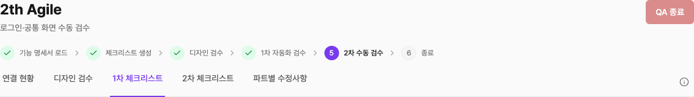 | 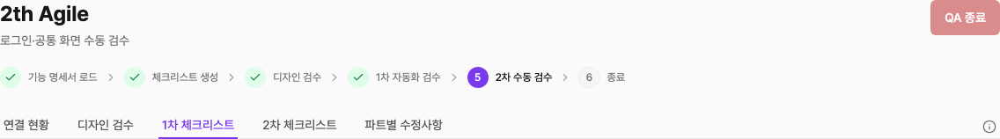 |
| K-7·K-8 상태 범례 | 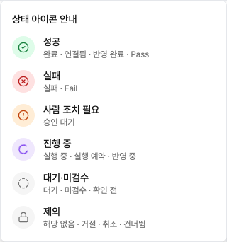 | 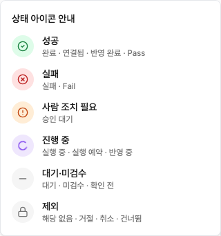 |
| K-7·K-9·K-13 디자인 미검수·중복 사유 | 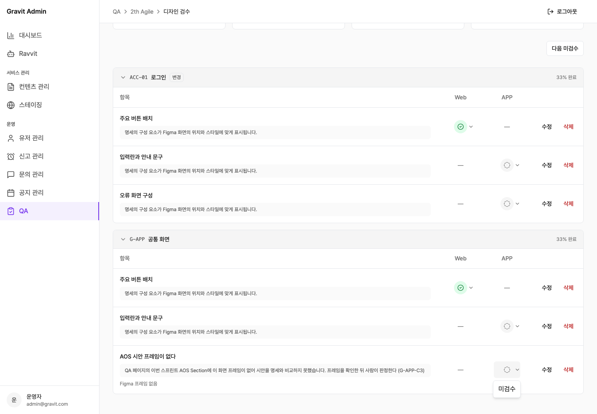 | 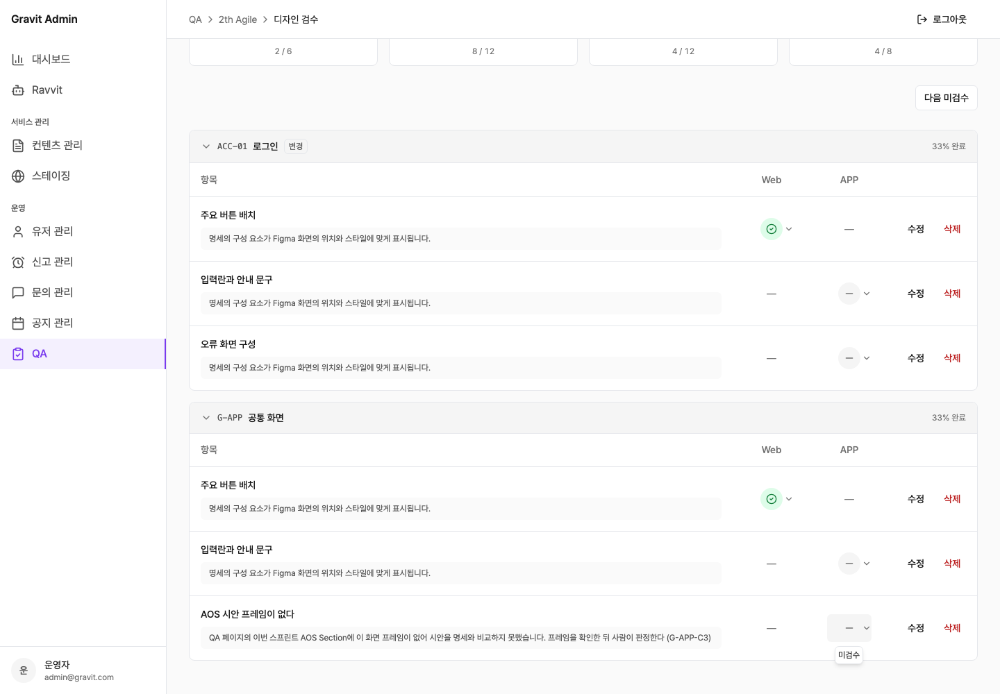 |
| K-9 반영 제안 상태 툴팁 |  | 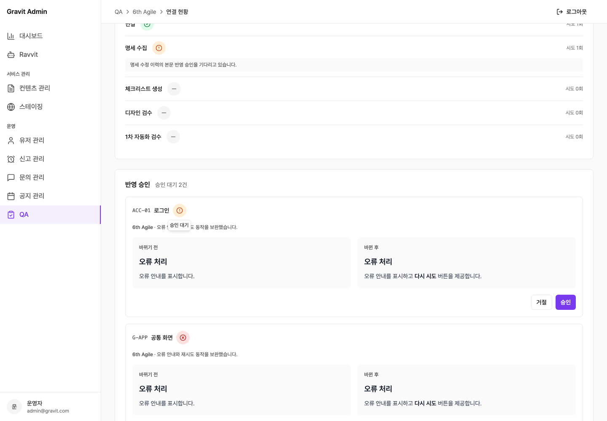 |
| K-10 Pass 툴팁 제거 | 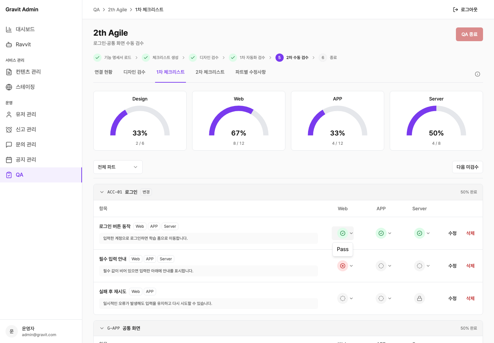 | 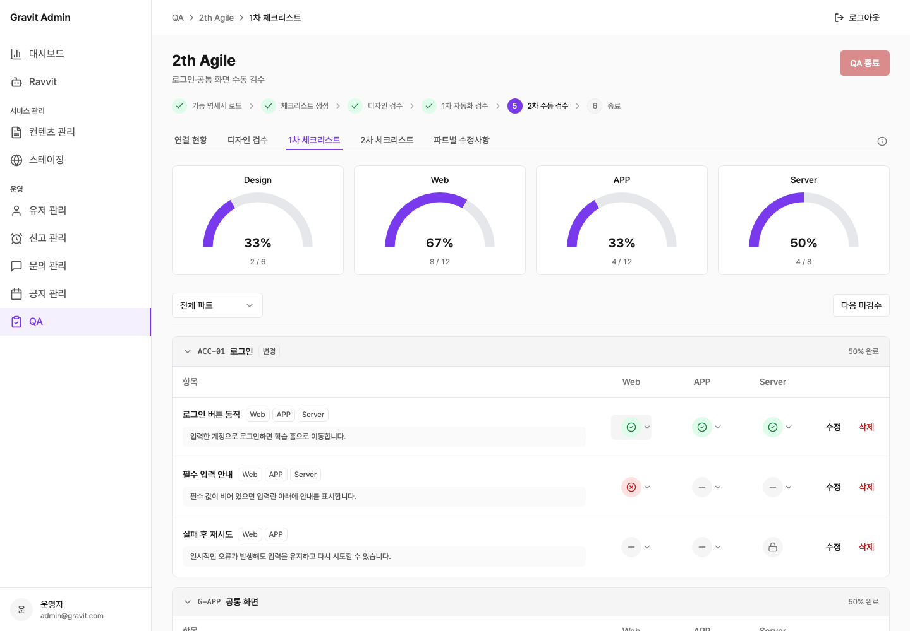 |
| K-16 표 머리글 | 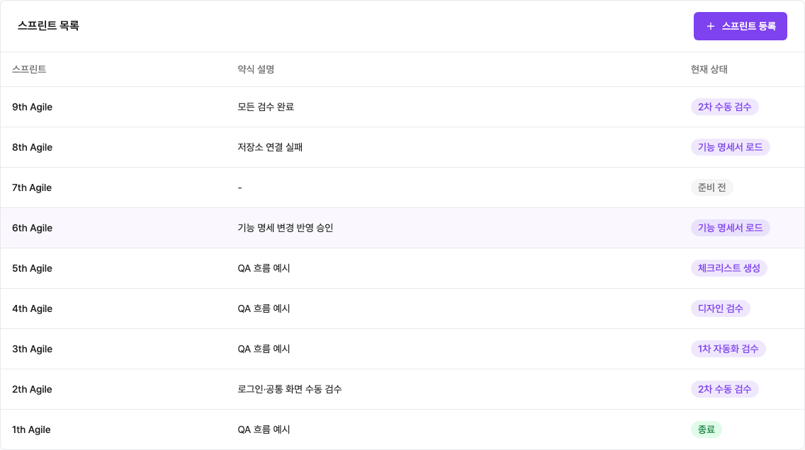 | 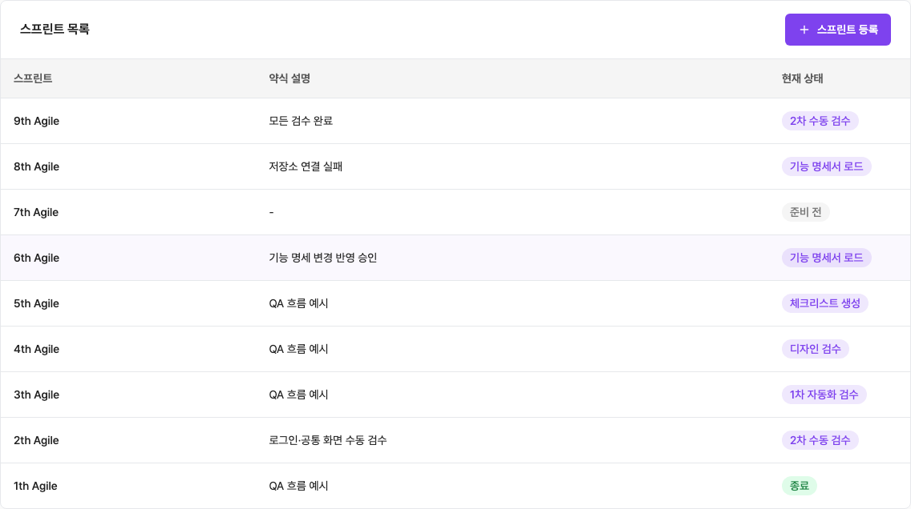 |

### K-11 재현 결과와 확인 한계

| 확인 | 결과 |
|---|---|
| 수정 전 확인창 오류 처리 | 기준 `SetupPanel` + 실제 서버 동작에 맞춘 MSW에서 409 후 dialog 1개 잔존. [기록](k11-baseline.json) |
| 수정 전 마지막 결정 | 같은 조건에서 마지막 승인 후 재수집 버튼 0개. 기존 `useReflectionDecision.onSettled → refreshSprint`가 이미 작동했습니다. |
| 당시 배포 정보 | 배포 커밋·URL은 사용자도 알지 못한다고 답하셨습니다. **당시 버튼이 남았던 정확한 원인은 정확하게 알지 못합니다.** |
| 이번 수정 | `waiting` 조건은 유지하고, 요청 종료 시 성공·오류 모두 창을 닫으며 `waiting=false`면 즉시 닫도록 했습니다. 기존 결정 후 재조회는 유지했습니다. |
| 수정 후 검증 | 마지막 승인·거절 후 스프린트 재조회, CHECKLIST·QA_PREPARE·SPEC_COLLECT DONE·버튼 제거 확인. 결정 응답 지연 중 열린 창, 재수집 409·500 확인창 닫힘 검증. |
| 검증 범위 | MSW 및 로컬 서버 소스 대조입니다. 실제 서버에 변경 요청을 보내거나 과거 배포의 원인이 해결됐다고 단정하지 않았습니다. |

| 기존 동작 회귀 | 결과 |
|---|---|
| Empty/Loading/Error/Data | 기존 전체 스모크에서 빈 목록·미생성·지연·조회 오류·데이터 상태 통과 |
| 사유창·이력·검증·이탈 보호 | 기존 취소·저장·길이 제한·충돌·변경 이력·나가기 스모크 통과 |
| 종료·잠금 | 종료 전 검증, 종료 후 이력, 해당 없음 이력 유지 |
| 키보드 | 범례 포커스·Enter·Esc·Tab 및 검수 전 셀 키보드 메뉴 차단 통과 |

## §F. 미해결·후속 제안

| 구분 | 내용 |
|---|---|
| 확인 한계 | K-11 당시 버튼 잔존의 정확한 원인은 미확정입니다. 재발 시 해당 배포 버전과 승인 직후 스프린트 응답을 함께 확인해야 합니다. |
| 후속 제안 | 기존 `fix:H1-CN_FONT_SIZE`, `fix:H2-MSW_BOOT_REISSUE` TODO는 별도 범위로 남겼습니다. |
| 사람 작업 | 리뷰 후 배포는 사용자께서 진행하십니다. |
| 정지 | 이번 리뷰 패킷 제출 후 다음 항목을 시작하지 않습니다. |

### 제출 후 승인 기록

| 날짜 | 사용자 지시 | 반영 범위 |
|---|---|---|
| 2026-11-13 | main 브랜치에서 커밋·푸시 | 이번 QA H2 수정·스모크·하네스·리뷰 증빙. 기존 사용자 작업 제외. 커밋 해시는 Git 이력과 최종 응답으로 보고합니다. |
